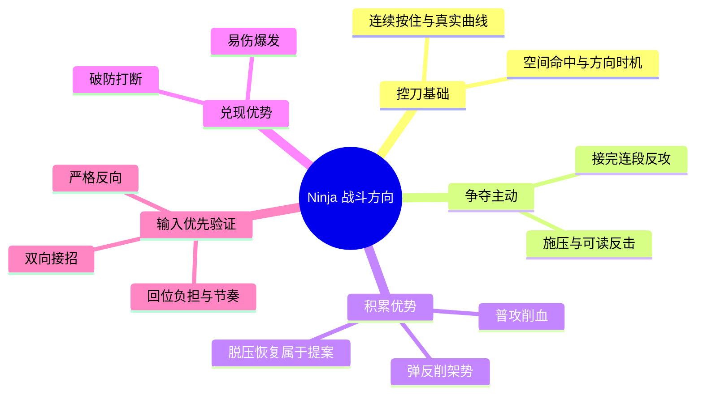
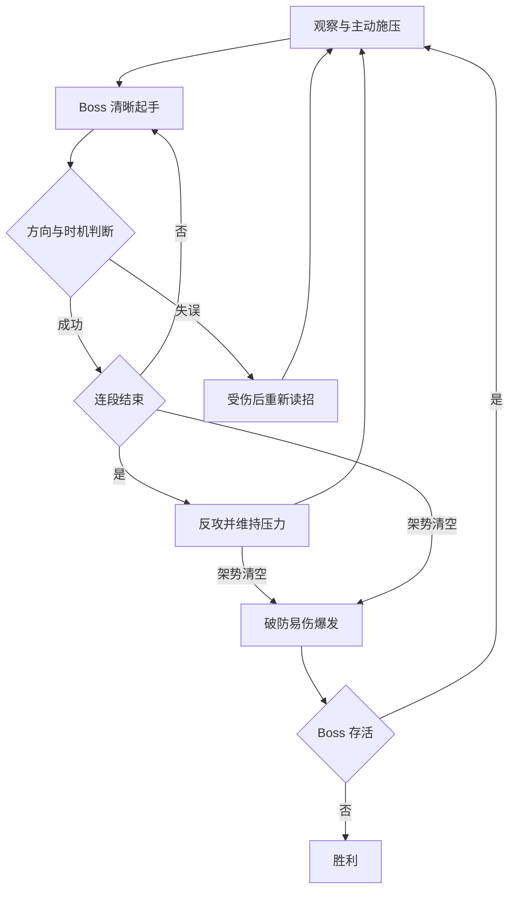

# Ninja 战斗设计讨论日志

项目：`E:\Godot\Ninja`  
起始日期：2026-10-22（Asia/Taipei）  
讨论来源：Codex 聊天「战斗逻辑」（`01a162f2-ca42-7f43-8851-5d19e730dd36`）  
用途：回顾设计过程，积累面试 Demo 的问题定义、设计取舍与迭代证据。

这是本聊天可见讨论的结构化回顾，不是逐字转录。早期项目背景来自现有代码和交接文件，不据此虚构本聊天未出现的讨论。重复发送的相同问题合并记录。

## 状态索引

| 编号 | 问题 | 当前状态 |
| --- | --- | --- |
| D001 | 如何借鉴《只狼》的战斗循环 | 已分析；完整新循环仍为提案 |
| D002 | 如何适配固定站位和连续鼠标控刀 | 已形成方向；新增系统未整体授权 |
| D003 | 同方向多连击是否造成无效回位与疲劳 | 用户提出的核心问题，待对照试玩 |
| D004 | 自动回弹能否解决光标及手部位移 | 已拆解；未采用自动回中/惯性控制 |
| D005 | 双向接招与严格反向如何取舍 | 两种已实现并完成规则/输入验证，待真人选择 |
| D006 | 如何避免乱摇过关、冷却吞弹反 | 训练规则已验证；自然操作与误识别仍待真人反馈 |
| D007 | 如何实施木桩 A/B 训练 | 已实现待试玩，验证结果见 D009 |
| D008 | 如何持续记录并服务面试 Demo | 本日志与项目协作约定已建立 |
| D009 | A/B 实现与验证结果 | 41 项训练检查及 97 项回归通过，真人手感未验收 |
| D010 | 精致 Demo 路线与策划面试目标 | 分阶段清单已建立，兼顾未来扩展为完整游戏 |
| D011 | 构图、UI与光影的统一目标 | 参考现有素材生成v02目标图，待用户确认 |
| D012 | 本地Git与第一份可运行基线 | Sol已完成本地基线及视觉资料提交；刀光3项已知失败已记录 |
| D013 | PC手感反馈、视角与方向手势 | 同向/交替初步舒适；方向斩击与固定斜俯视属于讨论提案 |
| D014 | 方向手势对战实验 | 已实现按5切换，原自由控刀按1保留；待用户试玩 |

## D001 · 2026-10-22 · 《只狼》战斗循环拆解

**用户问题**：希望拆解《只狼》战斗循环，结合现有游戏提出思路，并配思维导图。

**参考机制**：攻击和弹反推动敌人破架势；部分连段需要连续防御后才能还手；敌人血量越低，架势恢复越慢；破架势后忍杀兑现优势。

**设计归纳**：

- 每一刀：读前摇、方向与时机，选择进攻或接招。
- 每轮交锋：主动施压 → 应对反击 → 找到反攻机会。
- 整场战斗：削血使压制更容易保留 → 积累架势优势 → 破防兑现。
- 核心判断：“还能追一刀吗？该接招了吗？这一轮结束了吗？”

**对本项目的初始提案**：挥刀施压 → 读招转守 → 连续弹反 → 抢回主动 → 破防爆发。主动权代表风险和机会，不是强制锁住玩家操作的回合制。

**资料**：

- [Activision 战斗机制说明](https://support.activision.com/sekiro/articles/sekiro-shadows-die-twice-game-mechanics)
- [Xbox Wire 制作人访谈](https://news.xbox.com/en-us/2019/03/19/sekiro-shadows-die-twice-interview/)

**边界**：以上为机制参考和设计归纳，并非原作所有敌人都严格遵循同一节奏；用户尚未批准把所有提案加入原型。

## D002 · 2026-10-22 · 适配现有控刀原型

**已核实的基础**（本轮设计前）：固定站位；按住左键连续操控刀尖曲线；普通攻击看刀刃扫掠命中；弹反看局部方向与时机；Boss 架势从满值减至零后进入短暂易伤；玩家只有生命；普通命中不直接打断 Boss；成功弹反会结束当前单招并进入收招。详见 [实现交接](implementation-status.md) 和 [原型方案](combat-demo-plan.md)。

**提案及设计目的**：

1. 玩家施压触发带明确前摇的 Boss 反击，使敌人回应玩家行为。避免无预兆反伤、普通攻击无限重置敌人动作。
2. 区分单发、连段中间刀和终结刀：弹一刀只取消这一刀的伤害；接完连段再提供反攻窗口；任何时刻破防均中断连段。
3. 脱离有效压力一段时间后恢复 Boss 架势，血量低时恢复较慢。攻击和弹反都刷新压力宽限，避免玩家被迫防守时无故丢失进度。
4. 保留破防易伤和连续斩击，使精准接招累积的优势可见、可兑现；终结斩属于后续选项。
5. 初始招式建议：单次下劈、左右二连、横斩接延迟下劈；分别训练基础时机、连续转向、克制提前出手。

**仍需验证**：破防爆发的收益是否过高；是否能依靠动作而非仅看文字判断攻防；是否真的形成主动权变化。

**后续修正**：D003 指出手势存在回程，不能直接照搬按键动作游戏的连段。先验证自然手部运动，再确定完整 Boss 连段和节奏。

## D003 · 2026-10-22 · 连续同向攻击的回程负担

**用户观察**：按键弹反只需再次按下；手势弹反第一刀后，需要回手才能重复同方向动作。敌人连续三次同向攻击，会不会过于麻烦？

**拆解**：手势有空间行程和回程。三次反向弹反可能要求五次运动：“弹 → 回位 → 弹 → 回位 → 弹”。额外两次只用于重新摆位，可能把读招难度变成机械忙乱和手部疲劳。

**修正后的原则**：围绕自然、短幅度的手部运动设计招式；不先复制原作连段，再要求玩家适应。回程应尽可能具有战斗意义，或获得足够安全的时间。

**状态**：问题已明确，是否难受及何种方案更好尚需用户真人试玩；没有疲劳测量结果。

## D004 · 2026-10-22 · 惯性回弹、屏幕边界和物理边界

**用户提案**：刀被弹上去后自动向反方向回弹，手继续向前推；同时担心鼠标越来越偏向右上方。

**问题分层**：

| 层次 | 自动回弹的作用与限制 |
| --- | --- |
| 刀的视觉复位 | 可通过偏转、震动、短回弹表达碰撞 |
| 光标碰到屏幕边缘 | 自动刀动画不能解决；相对输入可以解除屏幕光标边界，但改变现有映射 |
| 手碰到鼠标垫边缘 | 相对输入和光标回中都不能替手完成物理回位 |

**提案**：先保持实际刀尖跟手，反弹主要表现于刀身/光效；过大的自动刀尖位移会削弱输入可预测性。先验证往返弹反，再考虑惯性控制。

**决定状态**：本次 A/B 实验不加入强制鼠标回中、捕获或自动漂移。没有否定未来试验，只是避免同时改变多个变量。

## D005 · 2026-10-22 · 两种接招规则的取舍

### A：双向接招（方向轴 + 时机）

- 水平敌招接受玩家左划或右划，竖直敌招接受上划或下划；仍要求局部有效运动和时间窗口。
- 同向三连可用“左 → 右 → 左”接住，使回程成为下一次有效操作。
- 优势假设：减少无效回位，手在小范围往返，避免同组动作持续累积位移。
- 代价：左右横斩不再要求不同方向答案；招式区分更多依靠横/竖/斜轴、快慢和停顿；乱摇偶然成功的风险需要验证。
- 动画可将两方向表现为迎刀弹开与顺势带开，但这是设计解释，不是已经完成的动画。

### B：严格反向（带符号的方向 + 时机）

- 保留原方向规则：Boss 左到右时玩家必须向左，反之亦然；下劈用上挑。
- 同向三连必须在接招间回位。
- 为使其舒服，可令快速连段左右交替，同向重复留足回位时间。
- 优势假设：保留明确的逆向迎击规则和左右差异。
- 代价：限制敌人的连续招式组合；同向快速重复可能造成额外负担。

**建议与用户决定**：讨论中偏向先测试 A，但用户未选最终模式。用户要求两种都加入木桩，亲自对比。公平对照须使用同一组招式和参数；另测交替连段，不能给 A 同向招式、B 交替招式后声称规则优劣已证实。

## D006 · 2026-10-22 · 手势边界、乱摇与冷却

**讨论中的风险**：允许双向后，持续左右摇动可能碰巧覆盖窗口；现有普通攻击与弹反共享最短出刀间隔，刚命中的普攻可能吞掉下一次正确弹反。

**训练实验要求**：

- 一次清晰挥动最多弹一次，新转向或停顿后重新启动才能获得新资格。
- 窗口前的旧动作不储存到窗口内；静止、抖动、按下瞬移、旧片段重用无效。
- 继续允许按住左键，不强制每刀松开；采用局部运动保留曲线与折返。
- 用短距离清晰动作完成接招，不靠大幅甩动制造难度。
- 训练回程不触发普通伤害，不消耗下一刀的弹反资格/冷却。

**范围说明**：完整战斗的普攻与弹反冷却拆分仍是后续设计项。本次优先隔离训练规则，避免改变正式战斗原有行为。

## D007 · 2026-10-22 · 木桩 A/B 实验实施

**用户授权**：“把这两个模式更新到咱们的木桩系统里，我来体验一下，一样用 sol 执行。”

**执行去向**：原聊天「Sol 执行：Ninja 曲线挥刀战斗原型」（`01a16187-4b93-74a1-9d5b-87b6c689fdff`），已发送具体任务。讨论聊天整理日志；Sol 负责代码、测试和实现交接，避免同时改同一文件。

**实验规格**：

- 在现有木桩中加入 A/B 接招训练，保留静止伤害测试、自由练刀和原战斗入口。
- 相同训练条件比较双向和严格反向；包含同向三连与左右交替三连。
- 三刀时刻固定，不被提前弹反/失败改写；组间提供回位时间；训练不因扣血或破防提前终止。
- 显示规则、敌方方向、玩家可接受方向、刀次及成功/失败结果；支持重开、模式切换和持续按住输入。
- 用独立训练参数，避免正式调试值（窗口 1 秒、容差 90 度等）使 A/B 失真；保留用户原资源。
- 不在本轮实现架势恢复、施压反应、忍杀、多阶段等其他提案。

**验证要求**：A 左/右/左接同向三刀；B 错方向失败且正确回位能成功；交替招式；错误轴和时间边界；同段重复、持续直拖、静止无效；切换重开清理；三连时序稳定；原模式回归。应区分规则测试、Godot/MCP 输入验证和用户手感验证。

**试玩记录入口**：Sol 将编写 `docs/parry-ab-playtest.md`；实际实现结果以该文件与 `docs/implementation-status.md` 为准。当前仅记录已派发，不提前声明实现完成。

**给后续试玩保留的观察项**：

1. 同向三刀接完是否需要明显挪动鼠标、抬鼠或大幅回手？
2. 能否说清楚失败原因：时机、方向，还是识别没有跟上？
3. 双向规则是否仍有对刀的感觉，是否容易无脑摇动通过？
4. 严格反向搭配交替连段是否自然？
5. 多组训练后哪种更愿意继续玩？疲劳或舒适度须由用户报告，不由自动测试推断。

## D008 · 2026-10-22 · 日志与面试 Demo

**用户目标**：该项目计划做成面试 Demo；本窗口每个问题、思路、拆解要能回顾，直接存 Godot 文件。

**落实**：建立本日志和根目录 `AGENTS.md`，提醒后续继续记录。保留被修正的提案与修正理由，并区分用户问题、设计建议、执行授权、自动验证、真人反馈与最终决定。

**面试叙述素材（尚非已验证成果）**：

> 从借鉴动作游戏的攻防循环出发，发现手势输入具有按键输入没有的回程成本。将视觉回弹、光标边界与物理手部位移拆开，提出双向接招和严格反向两套规则，通过同条件训练比较，再依据实际试玩确定取舍。

**证据约束**：后续应链接真实代码、运行截图、测试和用户反馈；没有获得的数据不补写为成果。不把辅助工具完成的实现写成独立手工完成，也不把规则检查通过写成手感已验证。

## D009 · 2026-10-22 · A/B 实现交付与监督复核

**用户补充**：额度中断后要求“继续监工 sol”。沿用原 Sol 执行聊天续做收尾，没有重复创建实现任务。

**已实现**：木桩内 A 双向接招 / B 严格反向，同向三连 / 交替三连，中文切换入口、固定落刀时序、每刀结果和组间休息。训练独立于普通伤害与正式调参，正式战斗仍保留原规则。

**试玩入口**：F5 → 4（木桩）→ G（弹反训练）；A/B 切规则，C 切连段，R 重开，Esc 暂停，T 返回静止木桩。也可打开 [独立训练场](../scenes/parry_ab_lab.tscn) 后 F6。切换、重开或暂停后需要重新按住左键；一组内可持续按住，不需每刀松开。

**执行证据**（Sol 在真实 Godot 中执行，监督聊天复核交接、测试代码与保存的 A/B 截图）：

- 训练自动检查最终为 **41 项，0 失败**；中间进度曾报告 40 项，之后补充首个输入样本时间锚点的真实前进时钟回归检查，最终以 41 项为准。
- 原战斗回归 **97 项，0 失败**。
- MCP 鼠标事件：A 同向三刀，左/右/左为 3/3；B 同手势为成功/失败/成功；B 加回位为 3/3；B 交替三连为 3/3。每组三刀之间没有松开左键。
- 实际训练不扣双方生命或架势，三刀时刻不随提前弹反或失败改变。

**可追溯文件**：

- [完整试玩说明、参数与限制](parry-ab-playtest.md)
- [实现交接](implementation-status.md)
- [规则测试](../tests/parry_ab_tests.gd)
- [A 同向三刀结果截图](screenshots/parry-ab-a-three.png)
- [B 相同手势结果截图](screenshots/parry-ab-b-same-input.png)
- [B 加回位结果截图](screenshots/parry-ab-b-return.png)
- [B 交替三连结果截图](screenshots/parry-ab-b-alternating.png)

**实际参数**：两规则同用 0.20 秒窗口、35 度容差、局部位移短边 2%、最低速度 180 逻辑像素/秒；每组落刀在 1.20 / 2.20 / 3.20 秒。新挥动可由清晰折返或至少 0.12 秒停顿后重启取得资格。均为可调实验起点，不是最终平衡。

**限制与待验证**：当前可玩连段仅水平；竖直匹配只做了规则检查。转角/停顿阈值可能把大圆弧划为新段，也可能忽略极短折返。输入注入和规则检查不能证明舒适、不疲劳或不会被真人乱摇利用。接下来由用户比较回位负担、方向理解、手感与误识别；尚未选择最终弹反规则。

## D010 · 2026-10-23 · 从原型走向精致 Demo 的推进清单

**用户请求**：列出进度清单，逐步把项目做成看起来较精致的 Demo。补充目标岗位为“游戏策划和战斗策划”，未来可能把游戏做完。

**本轮核对**：项目已有几何熊美术、双爪关节动作、编辑器预览及原有控刀/A-B训练；查看了最新交接和几何熊训练截图。玩家仍为占位形象，界面偏调试。交接中最新自动结果为战斗101、训练41、几何熊89项通过；本轮未重跑，不覆盖早期D009的历史结果。项目仍没有`.git`，正式资源保留生命10000、窗口1秒和容差90度等调试值。

**推进建议**：先把一个玩家、一只Boss、一个场景做成完整小体验，建议新玩家体验约3–5分钟，以实际试玩调整。阶段为：版本基线 → 手势规则 → 完整Boss循环 → 动作/音画反馈 → 视觉/UI统一 → 新手流程 → 打包和面试材料。详见 [Demo进度清单](demo-roadmap.md)。

**策划岗位重点**：每阶段留下目标体验、招式/数值设计依据、对照实验和真实反馈，能解释设计取舍；作品观感与可试玩性也必须完成，文档不能替代体验。

**长远取舍**：保留输入和战斗模块、招式配置及验证工具，未来可延伸完整游戏；暂缓多Boss、大量关卡、成长树等内容。第二种敌人出现真实复用需求时再提炼框架，不提前过度抽象。

**状态**：路线图已建立，属于推进建议；用户尚未选择A/B最终规则，也未授权本轮一次性实现全部阶段。本轮只更新文档，没有派发新代码任务。下一步先完成版本基线与A/B真人试玩反馈。

## D011 · 2026-10-23 · 以现有素材建立最终构图目标

**用户要求**：按照现有geocat、geobear和已制作UI Kit统一玩家、熊、场景、UI、字体与强调色，尝试光影；主角尚未制作，不急着定稿。

**参考与边界**：实际查看几何熊正面拼装、几何猫正式正面、UI Kit母板。Geocat是怪物与风格参考，不冒充主角。本图玩家为简化背影；遵循当前正面上下对峙而不是旧素材索引的侧视描述。

**方案**：大几何形状、粗深色描边、青蓝/奶油白配色，配合低对比几何森林遗迹；熊在上、玩家在下，中央留出控刀空间。沿用UI的切角外框、心/盾/骷髅图标、生命红/架势金/弹反青色；字体方向为清晰中文无衬线，真实字体接入与许可尚待确认。

**光影试验**：左上暖主光，冷色环境光，脚底接触影及向右下的长投影，刀刃接触处局部青光。角色保持大色块，光影提供体积而不引入写实皮毛。

**迭代**：第一张背景偏写实，且火花落在闲置前臂；第二张把场景改成简洁几何面，并移到挥击爪处。使用内置imagegen，未修改现有角色或UI源文件。

**交付**：[目标图](../assets/art/concepts/combat-composition-lighting-v02.png)、[设计规范](visual-target-art-direction.md)、[完整提示词](visual-target-prompts.md)。状态为生成概念图待确认，不是实机截图；还没有在Godot接入新场景、光照、HUD或正式玩家。

## D012 · 2026-10-23 · Git基线授权

**用户要求**：建立本地Git仓库与第一份可运行基线，核对忽略缓存、临时文件、敏感配置，并保留必要美术源文件；明确交由Sol。

**分工**：已委派原Sol执行聊天，要求审查暂存内容和体积、保留源码/源图/分件JSON/提示词/必要处理脚本、忽略本机连接配置和依赖缓存，执行本轮运行检查并记录提交。主聊天负责目标图和设计日志，避免同时修改同一文件；仅本地提交，不发布远程。

**证据入口**：完成后以 [Git基线记录](git-baseline.md) 及实际本地提交为准，不能以旧自动检查记录冒充本轮验证。

**完成补记**：Sol已创建可运行基线 `49f627e`，标签 `baseline-2026-10-23`；视觉图/设计资料单独提交 `fcdfdaa`，图片导入设置另行纳入。本次独立headless重跑战斗101、A/B41、几何熊89项均通过，主场景启动60帧成功。刀光16项中3项轨迹过期/暂停恢复检查失败，保留现状并记作已知问题，不声称所有测试通过，也不等同GPU视觉验收。沿用现有Git身份；未发布远程。缓存、本机MCP配置及常见敏感文件未纳入，源PNG、分件、JSON、脚本和文档均保留。

## D013 · 2026-10-23 · 镜头选择与手势控制对象

**用户反馈**：“交替和同向在PC上操作还算挺舒服。”记录为PC初步舒适度反馈，未据此认定每种完成3组、A/B已选择或长时间疲劳已验证。

**用户问题**：固定俯视、正视，或全方位但固定角度的视角如何选择，飞剑应怎样控制？补充另一方向：可以舍弃飞剑，只控制打击方向，同时保留手势。

**讨论假设**：暂将“全方位（固定角度）”理解为镜头朝向固定、角色可在地面向各方向移动。如果实际指镜头随角色绕转，需要单独讨论屏幕方向与世界方向的变化；本轮未把理解当作用户确认。

**拆解**：镜头朝向、角色移动能力、输入控制对象是三个独立选择。当前鼠标绝对位置控制刀尖，会同时承担定位与出刀；改为相对手势识别斩击，可将目标选择、攻击距离和斩击方向分开。光标任意位置短划可输入，不必回到敌人身上，但物理回手仍存在。

**视角取舍**：正面对峙最利于现有熊表情、双爪读招和当前资产复用；纯俯视利于位置、距离和多目标观察，但现有正面动作不能直接当俯视资产；固定斜俯视兼顾地面空间与角色轮廓，需要验证朝向、遮挡及近远向攻击的可读性。暂不建议同时引入自由旋转镜头与复杂空间控刀。

**方向手势提案**：锁定决定目标，距离决定能否触及，手势决定斩击方式（如横斩/上挑/下劈），时机决定攻防结果。保持屏幕方向规则；敌人在右上时，向左划表示对锁定敌人做左向横斩，而不是改为攻击屏幕左侧另一目标。挥动触发一段短动作，动作期间保留受击/取消规则，避免同一长轨迹反复触发。具体缓冲、可取消时刻与A/B判定仍待试验，不在本轮定死。

**收益与代价**：减少指针位置管理，为移动留出操作空间；代价是削弱“亲手画出真实刀路”的自由度，需要更好的斩击动作衔接和防止乱摇触发。手势仍保留方向/时机/连续变化的决策，但并非天然比刀尖直控更好。

**飞剑呈现可独立保留**：舍弃刀尖绝对位置直控，不必同时删除飞剑美术或设定；同样的方向指令可以驱动角色持剑或飞剑执行短斩击。主角设定尚未确认。

**建议与状态**：长期候选为固定斜俯视、目标锁定、方向手势；短期先在现有镜头和同一只熊上对比直控与方向输入，避免一次同时更改镜头、移动和输入。此轮只讨论并记录，未派发Sol、未改代码、未废弃当前原型和构图目标。待用户表达更偏向“自由画刀路”还是“用手势打有节奏的近身交锋”。

## D014 · 2026-10-23 · 授权方向手势对战原型

**用户决定**：先尝试方向手势与现有熊对打；飞剑暂沿手势方向移动，游戏内另加一个按键可体验的版本，由Sol执行。更倾向手势攻防路线，认为较便于设计深度；自由画刀路仍保留为另一方案。此为路线倾向，不是已验证的优越性。

**本轮规格**：新模式建议按5进入，1回原自由控刀战斗；镜头、站位和熊不变。空白位置短划即可给出方向指令，飞剑围绕熊执行同向短斩击，绝对鼠标位置不再控制刀尖；保留飞剑与刀迹，原自由曲线控刀不删。

**攻防约束**：新模式需有血量、架势、弹反、易伤和胜负的完整对战。一次清晰挥动启动一次动作，一动作最多结算一次命中；回位/启动定位不造成伤害。普通伤害随实际飞剑经过目标结算。新鲜反向弹反可打断普攻，取消旧动作后不补结算；旧手势不能储存成未来弹反。暂沿用严格反向作为新实验基线，不替用户选择A/B最终规则。

**比较边界**：新模式独立参数不覆盖正式资源；如使用默认可玩窗口/生命，而旧模式有调试参数，必须说明差异。先比较操控与衔接，不能将不同参数造成的难度变化当作输入方式更好。

**执行与状态**：已派发原Sol聊天。主聊天负责日志和路线图，Sol负责实现、检查、运行验证与 `docs/directional-gesture-playtest.md`。当前已授权实施，尚未报告完成；不扩展移动、镜头或其他Boss机制。

**完成补记**：Sol已交付实现提交 `2bef91d`。F5后按5进入方向手势，按1回原模式；连续按住可折返/停顿后重新出刀。飞剑按连续方向向量围绕熊受击区做440px、0.26秒短斩击；普通伤害随实际接触，定位和回位清轨迹且不伤害。弹反仍为窗口内新鲜严格反向手势，可取消普攻。动作尚未结束时的普通手势不缓存，此点需真人体验是否跟手。

**验证**：方向34、原战斗101、A/B41、熊89项规则检查通过，共265项。另在有画面的Compatibility渲染进程逐帧注入空白处右上短划，读取飞剑向量约(0.707,-0.707)，实际命中后熊生命290、架势94、结算1；查看保存的飞行截图。此验证使用受控时钟抓取动作，不等同默认渲染、真人连续对打和真实多帧率验收。原刀光3项过期失败未修复。

**参数差异**：新模式玩家100、弹反窗口0.20秒、容差35°；原模式仍使用用户调试参数（例如生命10000、窗口1秒、容差90°）。因此新模式更容易受伤不应直接归因于输入方式。完整操作与限制：[方向手势试玩](directional-gesture-playtest.md)。状态为已实现待用户反馈，路线倾向未当成手感定案。

## 后续追加模板

### Dxxx · YYYY-MM-DD · 问题标题

- 用户问题/观察：
- 当前实现或背景：
- 方案及设计依据：
- 主要取舍/风险：
- 用户决定与授权范围：
- 实施与证据链接：
- 试玩反馈与结论：
- 尚待验证/对历史提案的修正：
