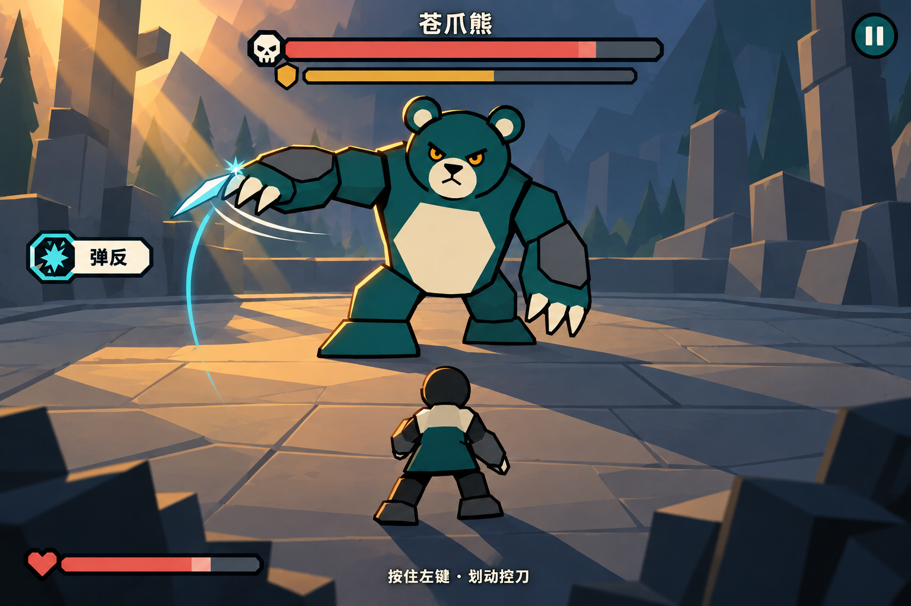

# 战斗构图与光影目标 · v02

日期：2026-10-23。状态：概念目标图已绘制，待用户确认；不是 Godot 实机截图、最终角色设计或已接入的光照效果。

## 参考与生成方式

使用内置 imagegen，以现有 geobear 正面分件拼装检查图、geocat 正面正式图、UI Kit 定稿母板为参考。第一稿验证冷暖光和构图；第二稿简化写实石材/植被为大几何面，并将弹反火花从闲置前臂移到正在挥击的爪处。保存最终第二稿，未覆盖任何现有生产素材。

- 熊形象：`assets/art/geometric/geobear/parts/front/assembled_preview.png` 中干净版本。
- 猫风格：`assets/art/geometric/geocat/geocat_stand_01_front.png`，用于校准几何轮廓、奶油白和灰蓝色块；不把猫当主角，也不在本场景增加第二只怪物。
- UI：`assets/art/geometric/ui_kit/boards/geometric_ui_concept_v1.png`，保留切角、粗近黑描边、图标和颜色关系；目标图中的组件为生成模拟，正式接入需使用已有透明组件和实时文字。
- 玩家：暂用简化背影，表达体量、站位和受光；服装、外形、身体设定均未定稿。

旧素材索引里“横版/侧视”是历史描述；本图遵循当前已确认的正面上下对峙。人物八方向图也不意味着本轮要做八方向移动。

## 构图关系

- 3:2 画幅，与当前 1152×768 视口比例相同；输出 1536×1024。
- 熊位于上半场中央，完整显示头、双爪和脚；约占画面高四成，攻击臂可以展开。
- 玩家小背影位于下方中央，浮空刀独立于手。双方之间有可读的地面与挥动空间。
- 主体居中；柱、树和前景暗块只在两边组织层次，不占据主要划刀区域。
- 这是带地面透视的2D分层构图目标，不要求改成3D，也不改变固定站位规则。

## 统一设计语言

| 层级 | 形状与明暗 | 作用 |
| --- | --- | --- |
| 角色 | 圆头、梯形/多边形体块、粗深色边；大色块，少量分面阴影 | 保留 geocat/geobear 身份和动作可读性 |
| 场景 | 大石板、切面柱、几何树；内部边线更弱，远景对比更低 | 有深度但不抢动作信息 |
| UI | 复用切角外框、盾/心/骷髅与圆形暂停钮；平面高对比 | UI 与角色轮廓呼应，文字不受场景光照影响 |
| 特效 | 短曲线刀迹、尖角小火花；局部发光 | 强调实际接触与当前刀路，不盖住下一招 |

## 色彩语义

沿用素材基础色，不进行整套重新配色。场景受光后可改变明度，角色主色识别应保留。

| 用途 | 建议基色 | 约束 |
| --- | --- | --- |
| 轮廓 | #06070B | 角色和UI强，远景边缘弱 |
| 熊/结构青蓝 | #196365 | 保持现有熊主体色 |
| 奶油白/象牙 | #FCECCB / #FFF9E6 | 腹部、爪与主要文字 |
| 灰甲/环境 | #5C5F66，偏冷灰蓝 | 环境饱和度低于角色 |
| 生命 | #DB6C60 | 心形/生命条，不与架势共用图标 |
| 架势 | #E8B54D | 盾形/架势条；清空代表破防，沿用当前规则 |
| 玩家刀迹/弹反 | #67D1CF | 青色只集中于交互焦点与对应UI |
| 易伤 | #9B7BC0 | 保留给破防后的状态；本张正常交锋图不显示 |

环境暖光不承担架势/弹反判定信号；战斗信息必须同时依靠图标、形状、动作和文字，避免仅看颜色。

## 光影方案

1. 左上暖光：照亮石板与熊左侧轮廓，建立主要光向。角色只增加少量边缘高光和一档阴影。
2. 冷色环境光：远景灰蓝、阴面青蓝，维持熊深青轮廓与背景的分离。
3. 接触阴影与长投影：脚底贴地，影子大体向右下，建立重量；活动关节的阴影细节后续按实现成本简化。
4. 局部青光：仅刀刃、接触火花附近提亮；不用全屏泛光掩盖角色细节。
5. 前暗后淡：前景暗角框出战场，远景雾化降对比。光束保持宽而稀疏，不当成持续闪烁特效。

后续可先用分层场景美术、独立脚底影与受光遮罩验证，再评估动态光照和性能。此图是效果目标，不保证所有投影都需要实时计算。

## HUD与字体

- 顶部中央：Boss 名称、生命条、较细的架势条，留开耳朵和抬爪空间。
- 左下：玩家生命；右上：暂停；底部中间：简短控刀说明，熟悉操作后可淡出。
- 弹反成功牌应短暂出现。正式游戏不要像静态示意图一样始终显示。
- 字体采用清楚的中等偏粗中文无衬线，主要名称更粗，正文较细；不采用书法/花体。当前生成图文字仅示意，不代表已有字体文件或完成授权检查。
- 建议在1152×768下试名称28–32px、状态22–26px、辅助说明18–20px；实际以显示和阅读验证调整。保证底板/描边对比，不把文字做进拉伸的血条贴图。
- 现成组件的切角与描边应保持厚度；正式接入前检查九宫格边距、条体拆分和少数切图残留。这里只统一方向，不修改 UI Kit 源文件。

## 需用户确认与后续工作

- 待确认：几何遗迹/森林场景、夕照冷暖关系、主体体量与留白是否符合期望。
- 玩家仅占位，当前不启动正式主角设定。
- 用户确认后，先搭静态场景和最小HUD，再接角色阴影/边缘光，最后加动态接触效果；保留低成本版本作对比。
- 将概念图与实机截图对照检查：黑色描边是否丢失、熊是否融入背景、爪是否清楚、提示是否遮挡、手势空间是否足够。

完整生成与修订提示词见 [visual-target-prompts.md](visual-target-prompts.md)。
